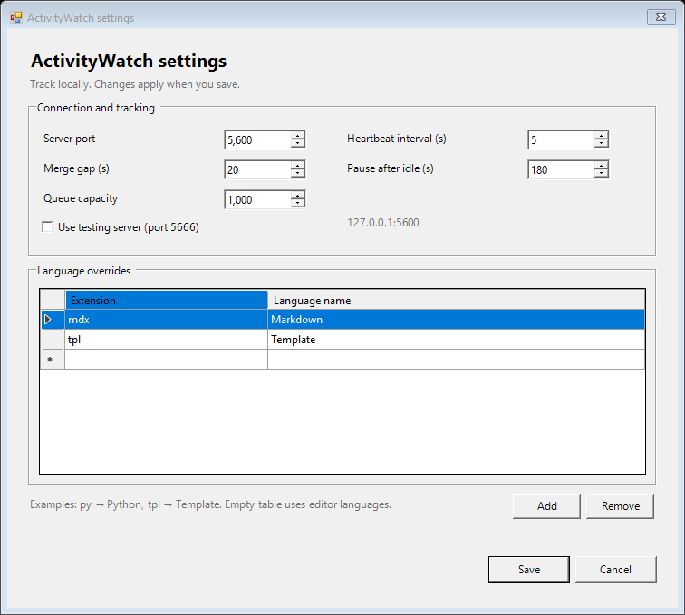

# AwWatcherNPP — ActivityWatch for Notepad++

Track the files, projects, and programming languages you work on in Notepad++ with
[ActivityWatch](https://activitywatch.net). Your activity stays on your computer.

## Features

- Records the active file, project name, and editor language.
- Detects Git, Mercurial, and Subversion project roots, including Git worktrees.
- Supports custom language names for file extensions.
- Includes a settings dialog with an editable language-mapping table.
- Tracks only while Notepad++ is in the foreground and pauses after inactivity.
- Sends heartbeats in the background and retries when ActivityWatch is unavailable.
- Provides 64-bit and 32-bit plugins for Windows.

The plugin records enabled file metadata, never document contents. It sends data
only to the local ActivityWatch server; no account or API key is required.

## Requirements

- Windows with .NET Framework 4.8.
- Unicode Notepad++ (64-bit or 32-bit; ARM64 is not supported).
- ActivityWatch running locally, normally on port `5600`.

Version 0.1.0 is an initial implementation. Both architectures have automated build
and protocol tests; validation inside a real Notepad++ installation is still pending.

## Installation

1. Get the archive matching your Notepad++ architecture from
   [Releases](https://github.com/pytlus93/AwWatcherNPP/releases), when available,
   or build it from source using the instructions below.
2. Close Notepad++.
3. Extract the `AwWatcherNPP` folder into your Notepad++ `plugins` directory.
   The resulting path must be `plugins/AwWatcherNPP/AwWatcherNPP.dll`.
4. Start ActivityWatch and restart Notepad++.

For a standard 64-bit installation, the DLL belongs at:

```text
C:\Program Files\Notepad++\plugins\AwWatcherNPP\AwWatcherNPP.dll
```

Use **Plugins → ActivityWatch → Open ActivityWatch** to open the dashboard.
Recorded events appear in **Raw Data** under `aw-watcher-notepadpp_<hostname>`.

## Settings

Choose **Plugins → ActivityWatch → Settings…** to change tracking options and
language overrides. Use **Add** to create a mapping or **Remove** to delete selected
rows. Click **Save** to apply changes immediately; **Cancel** leaves your settings
unchanged. Duplicate extensions, incomplete rows, and invalid intervals are rejected.



The plugin saves settings in `AwWatcherNPP.json` in Notepad++'s plugin configuration
directory. Existing JSON settings remain supported. For example:

```json
{
  "Port": 5600,
  "Testing": false,
  "FrequencySeconds": 5,
  "PulseTimeSeconds": 20,
  "IdleSeconds": 180,
  "QueueCapacity": 1000,
  "Languages": {
    "tpl": "Template",
    "mdx": "Markdown"
  }
}
```

- `FrequencySeconds`: heartbeat interval, from 1 to 60 seconds.
- `PulseTimeSeconds`: maximum gap for merging matching heartbeats; at least the
  heartbeat interval and at most 120 seconds.
- `IdleSeconds`: pause after this many seconds without Windows input.
- `QueueCapacity`: maximum number of pending heartbeats, from 1 to 10,000.
- `Languages`: extension overrides; matching ignores case. A leading dot is optional
  in the table and removed on save. Wildcards and compound extensions are rejected.
- `Testing`: selects port `5666` when `Port` is left at `5600`.

Set `Languages` to `{}` to use the editor's language names without overrides.

## Tracking behavior

File and language changes produce an immediate heartbeat. While focused, reading
is counted until the idle timeout. Switching to another application pauses tracking.

When enabled, the project path comes from the nearest version-control root, or the file's parent
folder when there is no root. Unsaved buffers use their tab label and an empty project.

Events use ActivityWatch's `app.editor.activity` bucket type and contain `file`,
`project`, and `language` fields plus the workspace-required `title`. See [data contract](DATA-CONTRACT.md) for settings, migration and privacy. Combine them with ActivityWatch's window and AFK
information when calculating time; overlapping watcher totals should not be added.

Pending heartbeats are kept in memory and retried in order, including when settings
are changed. A full queue rejects
new events, and pending events are lost when Notepad++ exits or crashes.

Focus/idle returns and sampling gaps larger than the heartbeat interval plus one
second begin a new interval with `pulsetime=0`. Queue overflow also marks the next
accepted observation as a boundary. Retries retain observation UTC timestamps.
Server outages with uninterrupted, successfully queued observations retain observed
activity; collection gaps are not filled with stale observations.

See [validation evidence and limitations](VALIDATION.md).

## Troubleshooting

Check **Plugins → ActivityWatch → Status** for connection status and queued or
dropped events. Confirm that ActivityWatch is running on the configured port and
that the DLL architecture matches Notepad++.

Diagnostics are written to `AwWatcherNPP.log` beside the configuration file without
file paths or document contents. Invalid settings disable tracking until corrected.
If Notepad++ cannot provide its configuration directory, the fallback is
`%APPDATA%/AwWatcherNPP`.

## Building and contributing

Install Visual Studio with MSBuild and the .NET Framework 4.8 developer pack, then
run from the repository root:

```powershell
./scripts/build.ps1 -Platform x64 -Test -Package
./scripts/build.ps1 -Platform x86 -Test -Package
```

The first build downloads pinned export tooling into `.tools/`. Release archives
are generated in `dist/`. Tests cover tracking, event serialization, HTTP requests,
retry recovery, queue limits, cancellation, and native plugin exports.

Before submitting a change, run the tests and check file switching, editing,
saving, Unicode paths, both editor panes, idle behavior, and server recovery in
Notepad++. Include your Notepad++ version, architecture, and validation results
in bug reports or pull requests.

See the [ActivityWatch watcher guide](https://docs.activitywatch.net/en/latest/watchers.html#custom-watchers)
and [REST API documentation](https://docs.activitywatch.net/en/latest/api/rest.html)
for integration details.

## Thanks

Thanks to **Alan Hamlett** and the contributors to the
[WakaTime Notepad++ plugin](https://github.com/wakatime/notepadpp-wakatime), whose
plugin integration provided the starting point for this watcher.

## License

[BSD 3-Clause](LICENSE.txt), including attribution for adapted plugin integration.
